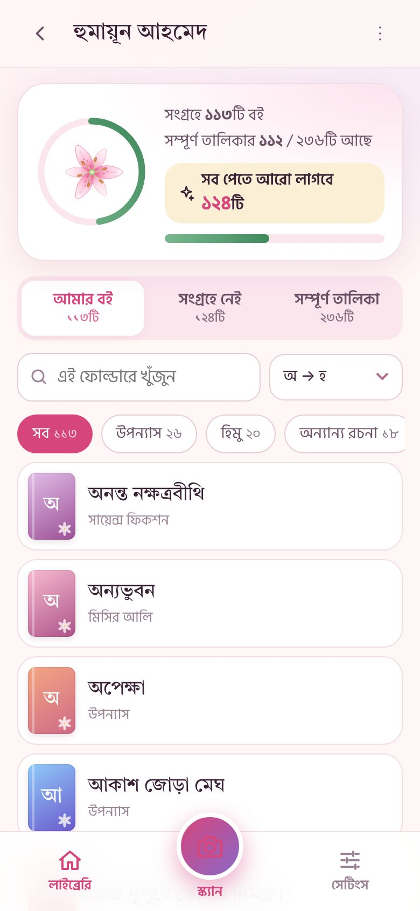
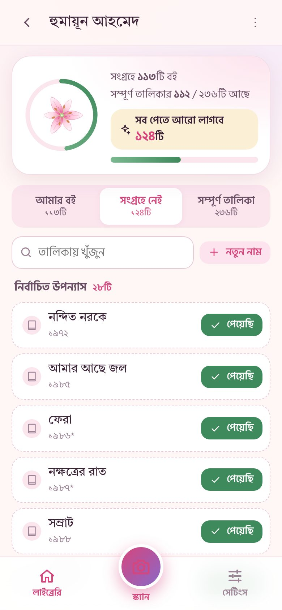
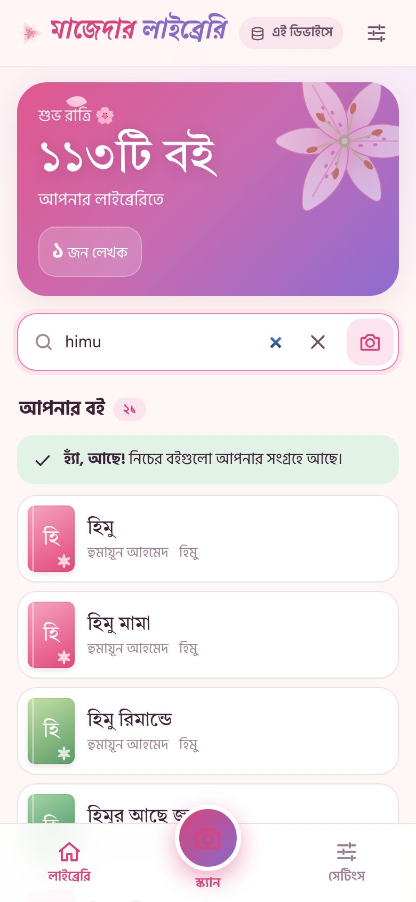
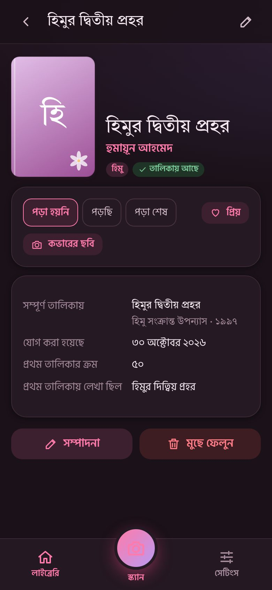

# 🌷 মাজেদার লাইব্রেরি

বইয়ের জন্য একটা ছোট্ট বাগান — নিজের সব বই এক জায়গায় রাখা, খোঁজা আর ক্যামেরা ধরে চেনার অ্যাপ।

**ঠিকানা:** https://jarifalamclaude-max.github.io/MazedarLibrary/ (GitHub Pages চালু করার পর — [সেটআপ গাইড](docs/SETUP.md))

<p align="center">
  <a href="docs/promo/mazedar-library-promo.mp4"></a><br>
  <b>🎬 <a href="docs/promo/mazedar-library-promo.mp4">প্রোমো ভিডিও দেখুন</a></b> (৩৬ সেকেন্ড, শব্দসহ)
</p>

<p align="center">
  
  
  
  
  
</p>

## কী কী করা যায়
- **লেখকের নামে ফোল্ডার** — প্রতিটি লেখকের বই আলাদা, প্রত্যেকের পাশে বইয়ের সংখ্যা।
- **হুমায়ূন আহমেদের কাউন্টার** — সংগ্রহে কয়টি আছে, আর সব বই পেতে **আরো কয়টি লাগবে** (সম্পূর্ণ তালিকা ২৩৬টি নাম, এখন ১২৪টি বাকি)। “সংগ্রহে নেই” তালিকা থেকে “পেয়েছি” চাপলেই যোগ হয়; নতুন নাম পেলে তালিকায় যোগ করা যায়। চাইলে যেকোনো লেখকের জন্যও এমন তালিকা বানানো যায়।
- **খোঁজা** — বাংলায় বা Banglish-এ (যেমন `himu`, `misir ali`, `jochona`); বানানের ছোটখাটো পার্থক্য (আলী/আলি, যাব/যাবো, ময়ুর/ময়ূর) নিজেই মিলিয়ে নেয়।
- **ক্যামেরা স্ক্যানার** — বইয়ের মলাট ধরলে বলে দেয় বইটা আছে কি না, অথবা নাম-লেখকসহ যোগ করার ফর্ম খুলে দেয়। ইন্টারনেট ছাড়াও চলে (ফোনের ভেতরের OCR); ইন্টারনেট থাকলে Google Gemini দিয়ে আরো নির্ভুল।
- **বাংলা বর্ণানুক্রমে সাজানো** (অ → হ, বাংলা একাডেমির অভিধানের ক্রমে), সাম্প্রতিক, তালিকার ক্রম, ধরন অনুযায়ী।
- **সবকিছু বদলানো যায়** — নাম, লেখক, ধরন, প্রকাশনী, ISBN, কপির সংখ্যা, পড়ার অবস্থা, প্রিয়, নোট, কভারের ছবি।
- **অফলাইন** — একবার খুললে ইন্টারনেট ছাড়াই পুরো অ্যাপ চলে (ফোনে ইনস্টল করা যায়)।
- **দুই ফোনে একসাথে** — একই ইমেইল-পাসওয়ার্ডে লগইন; একজন বই যোগ করলে কয়েক সেকেন্ডে অন্যজনের ফোনে চলে আসে, অফলাইনে করা পরিবর্তনও পরে মিলে যায়।
- **তথ্য না হারানো** — প্রতিটি ফোনে পুরো কপি + ক্লাউড কপি, মুছলে আগে ট্র্যাশে যায়, প্রতিদিন স্বয়ংক্রিয় ব্যাকআপ, ব্যাকআপ ফাইল/এক্সেল/প্রিন্ট।
- **লিলি আর ফুলের সাজ** — হালকা আর গাঢ় দুই রঙেই।

## সেটআপ
[docs/SETUP.md](docs/SETUP.md) — GitHub Pages (২ মিনিট), Firebase ক্লাউড সিঙ্ক (১০ মিনিট), Gemini স্ক্যানার (২ মিনিট); সবই ফ্রি।

## For developers
Static PWA, plain ES modules, no runtime build. Preact + htm UI, IndexedDB local store,
field-level last-writer-wins replication over Firestore (local-first; Firestore is only the
sync channel), tesseract.js (Bengali + English) offline OCR, Gemini REST for online OCR.

```
npm install          # dev tooling only (vendor/ output is committed)
npm run build        # rebuild vendor bundles + sw.js precache list
npm test             # unit tests (node:test)
npm run e2e          # browser tests (Playwright/Chromium)
npm run e2e:sync     # two phones syncing through the Firebase emulators (needs Java)
node tools/serve.mjs 8080       # serve locally
```
Architecture and module contracts: [docs/ARCHITECTURE.md](docs/ARCHITECTURE.md) ·
Data provenance and decisions: [docs/DATA-NOTES.md](docs/DATA-NOTES.md)
